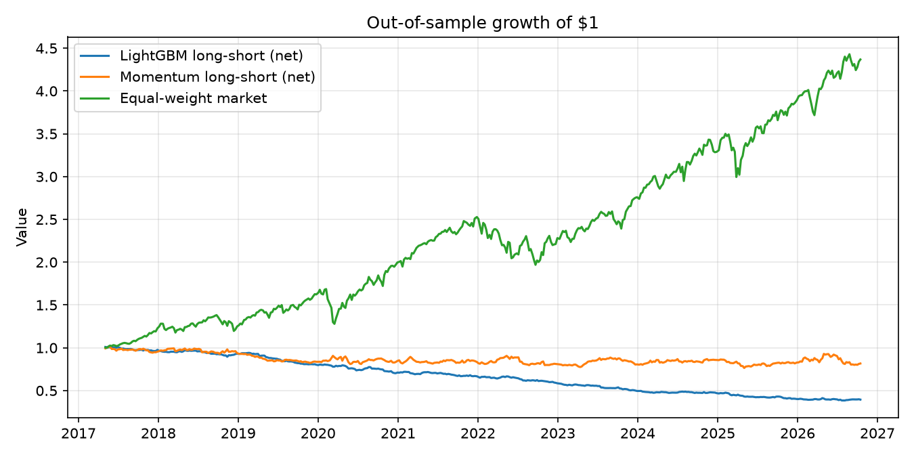
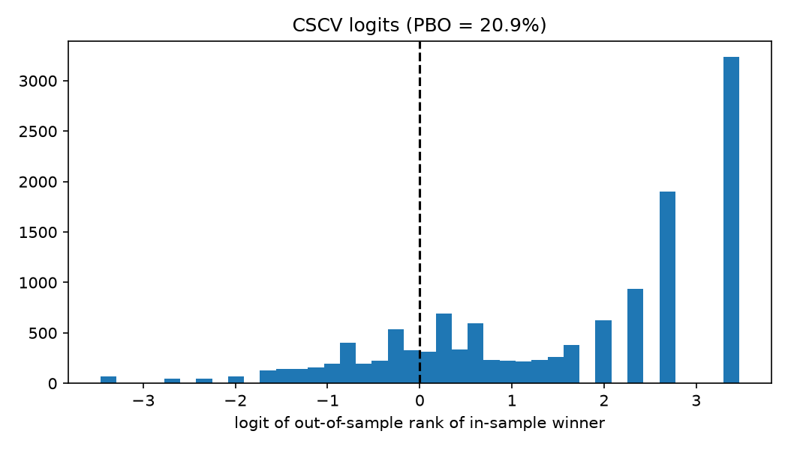

# Cross-Sectional Equity Signal Research, with an Overfitting Audit

**Result: the strategy does not work.** A LightGBM model ranking 50 US large
caps by next-week return showed no predictive edge out of sample, lost money
even before transaction costs, and lost much more after them. None of the 32
variants tested made money. The overfitting audit confirms the best variant
is no better than luck.

This repo is a record of a falsified hypothesis, built so that the negative
result can be trusted: no look-ahead leakage, purged walk-forward training,
realistic costs, and every variant tried is kept and reported.



## Results

Out-of-sample period: May 2017 to October 2026 (476 weeks), 50 stocks,
10 bps transaction costs per unit traded.

| Strategy                          | Sharpe    | Annual return | Annual vol | Max drawdown | Weeks up |
| --------------------------------- | --------- | ------------- | ---------- | ------------ | -------- |
| LightGBM long-short, net of costs | **-1.64** | -9.7%         | 5.9%       | -61.9%       | 39.1%    |
| LightGBM long-short, before costs | -0.41     | -2.4%         | 5.9%       | -30.7%       | 46.8%    |
| 60-day momentum long-short, net   | -0.16     | -1.6%         | 10.1%      | -24.8%       | 51.3%    |
| Equal-weight market, long only    | 1.13      | 16.7%         | 14.8%      | -24.1%       | 63.0%    |

- **No predictive signal.** The mean information coefficient (per-week rank
  correlation between predicted and realized returns) is **-0.008, t-stat
  -1.25**: statistically indistinguishable from zero, and slightly negative.
- **Losing before costs.** The gross Sharpe of -0.41 means the problem is
  not just trading costs: the model's rankings were not useful.
- **Costs make it much worse.** Average weekly turnover is 1.44 (the
  portfolio replaces most of its positions every week). At 10 bps that costs
  about 7% a year, turning -2.4% gross into -9.7% net.
- **The model did worse than a one-line rule.** Plain 60-day momentum lost
  a little (-1.6% a year); the machine-learning model lost far more.
- **The market line is not a fair comparison.** It is long-only and carries
  market risk the long-short avoids, and its 4.4x growth is inflated by
  survivorship bias (see Limitations).

### Overfitting audit (32 variants)

|                                      |                                         |
| ------------------------------------ | --------------------------------------- |
| Best variant                         | `no_reversal_leaves7_trees100_train156` |
| Best net Sharpe                      | -0.94                                   |
| Best Sharpe expected from luck alone | 0.55                                    |
| Deflated Sharpe Ratio                | **0.000**                               |
| Probability of Backtest Overfitting  | 20.9% (12,870 CSCV splits)              |

- **Deflated Sharpe Ratio of 0.** Even the best of 32 variants is far below
  the Sharpe that pure luck would produce from 32 tries. There is no
  evidence of an edge.
- **Read the PBO carefully.** A PBO of 21% is low, which normally suggests
  the in-sample winner tends to stay good out of sample. Here every variant
  loses money, so it only means the _ranking of losers_ is fairly stable.
  The top four variants are all the smallest trees (7 leaves).
  `results/audit.md` reports whether that ranking tracks each variant's
  turnover or its performance before costs. A low PBO is never evidence
  of profitability on its own.



## Why it likely doesn't work

These are plausible explanations, not tested claims:

- **Efficient universe.** The 50 largest US stocks are the most heavily
  traded and analyzed in the world. Simple price patterns there are
  arbitraged away quickly.
- **Well-known features.** Momentum, reversal, volatility and
  moving-average distance are textbook signals that many funds already
  trade.
- **Noisy horizon.** One-week returns for mega-caps are dominated by news
  and market-wide moves, leaving little stock-specific signal to learn.
- **Small portfolio.** Each side holds 10 stocks, so results are noisy and
  costs are a large share of any edge.
- **High turnover.** Weekly rebalancing on a noisy signal pays costs to
  chase noise.

## What a next attempt would need

Each of these is a new hypothesis. It must be added to the audit as more
trials, not tuned until the curve goes up.

- A longer horizon (monthly rebalancing with a 20-day label) to cut costs
  and target better-documented effects.
- Turnover control: smoothing predictions over several weeks, or only
  trading when a stock's rank changes by a meaningful amount.
- Information beyond past prices (fundamentals, earnings surprises, news),
  since price-only features showed no edge here.
- A larger, survivorship-free universe.

## Pipeline

```
data.py       download daily adjusted closes (yfinance), cache to data/
features.py   point-in-time features + forward-return labels, one row per (week, stock)
model.py      purged walk-forward LightGBM: train on the past, predict the next quarter, roll
portfolio.py  long top 20% / short bottom 20%, transaction costs, metrics
run.py        main backtest vs a momentum baseline and the market
audit.py      32 variants -> Deflated Sharpe Ratio + PBO (CSCV)
tests/        look-ahead (truncation) test, label timing, audit sanity checks
```

## Method

**Timeline of one decision.** Features are computed at the close of day _t_.
The position is entered at the close of _t+1_ (you can't trade at the close
you used to decide) and exited at the close of _t+6_, one trading week later.
Features use only prices up to _t_; the label is the only thing that uses the
future.

**Features** (each a hypothesis about next week's relative return):

| Feature            | Definition                       | Idea                  |
| ------------------ | -------------------------------- | --------------------- |
| `mom_5`            | 5-day return                     | short-term reversal   |
| `mom_20`, `mom_60` | 20- and 60-day return            | momentum              |
| `vol_20`           | std of the last 20 daily returns | low-volatility effect |
| `ma_dist_50`       | price / 50-day average - 1       | stretch vs trend      |

**Cross-sectional ranking.** On each date every feature and the label are
converted to percentile ranks across stocks. The model learns _which stocks
beat the others_, not where the market goes; ranks stay comparable across
calm and volatile regimes; and a same-day rank cannot leak future
information (a global z-score would). Features are ranked _before_ dropping
rows without a label, because whether a label exists depends on the future.

**Purged walk-forward.** Each model trains on the previous 3 years of weekly
samples and predicts the next 13 weeks, then rolls forward. A training row is
used only if its outcome was already known before the first test decision,
so the last week before each test block is purged.

**Leakage test.** `tests/test_features.py` rebuilds the dataset with all
data after a cut-off date deleted and checks that every feature, and the set
of rows, up to that date is unchanged. It was verified to fail on three
deliberately planted look-ahead bugs.

**Portfolio.** Long the top 20% of predicted ranks, short the bottom 20%,
equal-weighted, +0.5 / -0.5 (gross exposure 1, market-neutral by
construction). Costs of 10 bps per unit of turnover are charged at each
weekly rebalance.

**Baselines.** A single-factor 60-day momentum long-short (does the model
beat a one-line rule?) and the equal-weight market (context only).

## Overfitting audit: method

`audit.py` runs a grid of 32 variants (4 feature sets x 2 tree sizes x
2 ensemble sizes x 2 training windows) on the same out-of-sample weeks and
keeps all of their returns.

- **Deflated Sharpe Ratio** (Bailey & Lopez de Prado, 2014). Under the null
  that every variant has zero true Sharpe, the best of _N_ trials is still
  expected to show a positive Sharpe. The DSR computes that expected maximum
  from the dispersion of the trials' Sharpe ratios and tests the best variant
  against it, adjusting for skewness and fat tails. Output: the probability
  that the best variant's true Sharpe is above zero.
- **Probability of Backtest Overfitting** (Bailey, Borwein, Lopez de Prado &
  Zhu, 2017), via combinatorially symmetric cross-validation. The weekly
  returns are cut into 16 blocks. For each of the C(16,8) = 12,870 ways to
  split them into two halves, the best variant on one half is located on the
  other half. PBO is the fraction of splits where the in-sample winner ranks
  at or below the out-of-sample median.

The tests check both on known cases: 30 pure-noise strategies give PBO near
50% and a low DSR; adding a genuine edge to one strategy gives PBO near 0
and DSR near 1.

## How to run

```bash
python -m venv venv
source venv/bin/activate        # Windows: venv\Scripts\activate
pip install -r requirements.txt

python data.py      # download prices
python -m pytest    # leakage and sanity tests
python run.py       # main backtest -> results/summary.md, equity_curve.png
python audit.py     # overfitting audit -> results/audit.md, variants.csv
```

Prices come from Yahoo Finance and are revised over time, so a re-run on a
later date will give slightly different numbers.

## Limitations

- **Survivorship bias.** The universe is today's large caps, chosen with
  hindsight. Stocks that fell out of the index are missing, which flatters
  long-only results and can distort the long-short.
- **Close-to-close execution.** Trades assume the closing price, no market
  impact, and no short-borrow fees, so real results would be somewhat worse.
- **Weight drift** within the week is ignored when computing turnover.
- **Correlated trials.** The 32 variants are far from independent, so the
  effective number of trials is lower than 32. This makes the DSR's luck
  benchmark conservative. With every variant losing money, the conclusion
  does not depend on it.
- **One universe, one period.** The result applies to US mega-caps in
  2017-2026 and says nothing about other markets or horizons.

## References

- Bailey, D. H., & Lopez de Prado, M. (2014). The Deflated Sharpe Ratio:
  Correcting for Selection Bias, Backtest Overfitting and Non-Normality.
  _Journal of Portfolio Management_, 40(5).
- Bailey, D. H., Borwein, J., Lopez de Prado, M., & Zhu, Q. J. (2017). The
  Probability of Backtest Overfitting. _Journal of Computational Finance_,
  20(4).
- Lopez de Prado, M. (2018). _Advances in Financial Machine Learning_. Wiley.
  (purged cross-validation)
